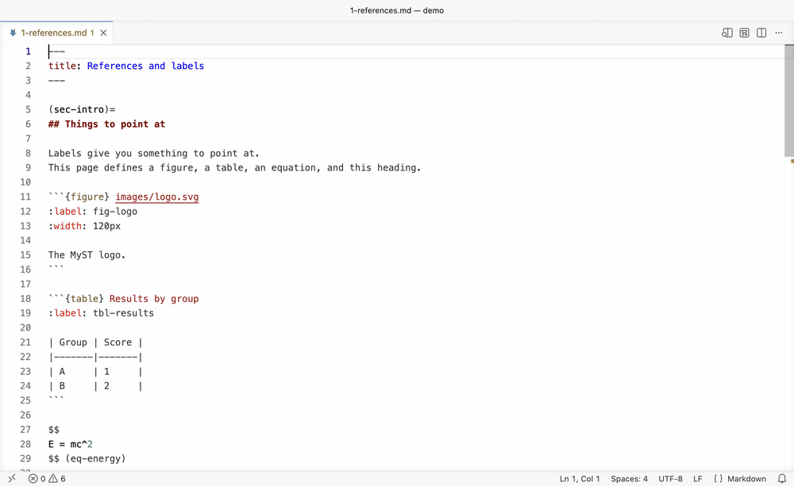

# mystmd-lsp

[](https://codespaces.new/choldgraf/mystmd-lsp)
[](https://mybinder.org/v2/gh/choldgraf/mystmd-lsp/main?urlpath=lab/tree/index.md)

A language server for [MyST](https://mystmd.org) projects, built on the mystmd engine.
It speaks the [Language Server Protocol](https://microsoft.github.io/language-server-protocol/) (LSP), so it works in any editor with an LSP client.

It reads your project through mystmd, so completion and warnings cover every page, not just the open one.
It has a VS Code extension, and [MyST Author](https://chrisholdgraf.com/myst-author/) builds on it with a live preview.
See [editor setup](docs/editors.md) for both.



**Warning**: This is experimental and evolving rapidly! See "Project status" below.

## Install

In VS Code, install the [MyST Language Server](packages/vscode/README.md) extension.
Other editors need the server on your `PATH`:

```sh
npm install -g mystmd-lsp
```

This needs Node 22.18 or newer, and [mystmd](https://mystmd.org/guide/quickstart) for project-wide features.

## Run

Point your editor's LSP client at `mystmd-lsp --stdio` for Markdown files.
A file gets features when it's a page of a MyST project, as described in [finding the project](docs/configuration.md#finding-the-project).
See [editor setup](docs/editors.md) for examples, and [troubleshooting](docs/troubleshooting.md) if something doesn't work.
The [demo project](demo/index.md) walks through each feature.
The Codespaces badge above opens it in VS Code with the extension, and the Binder badge opens it in JupyterLab through jupyterlab-lsp.

## What you get

- Completion for references, citations, files, directives, roles and directive options.
- Links to labels and objects in external projects, through `xref`.
- Hover, go to definition, find references, and rename for labels.
- Warnings for unknown references, missing figure and include files, and duplicate labels.
- Inlay hints about what a reference points to, plus outline and workspace symbols.
- Markdown cells in notebooks, in JupyterLab or VS Code.

See [features](docs/features.md) for the full list.

## Inspiration

This takes inspiration from chrisjsewell's [myst-lsp](https://marketplace.visualstudio.com/items?itemName=chrisjsewell.myst-lsp).

## Project status

Currently, this is being developed primarily for its author, Chris Holdgraf, to have VSCode and JupyterLab LSP support for the mystmd engine!
It's also a way to explore how complex it would be to implement some of this core functionality using the capabilities of that engine.
So treat it as part "alpha product", part "prototype for experimentation", and part "hopefully useful tool".
If the Jupyter Book team ever wants to use `mystmd-lsp` for its npm package I'm happy to donate this repository and/or the `mystmd-lsp` npm name to the project!

Note: This is being developed with a fair amount of Claude support, though with a lot of heavy loops of review and design work w/ a human.

To contribute, see [Contributing](docs/contributing.md).
